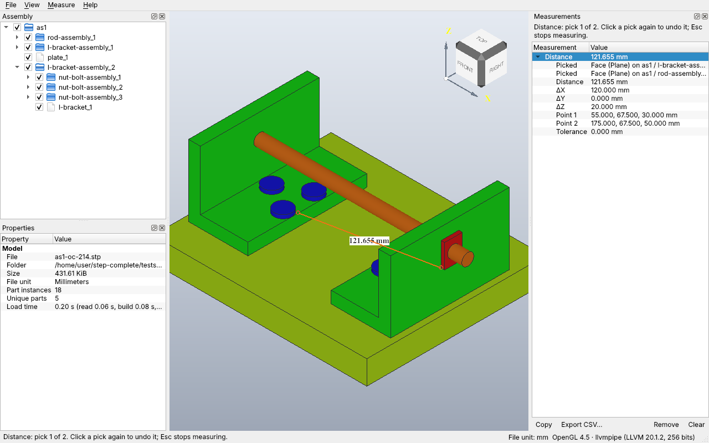
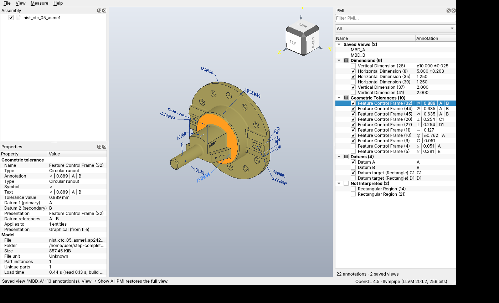
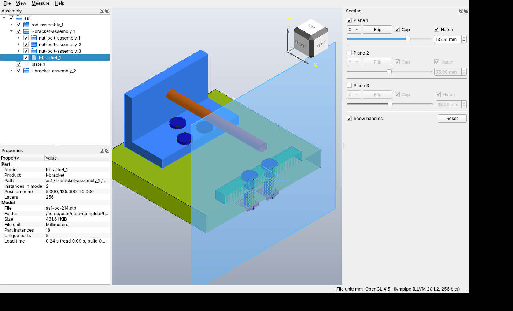

# STEP Complete

A fast, lightweight, cross-platform viewer for STEP CAD files (AP203 / AP214 / AP242), with
accurate measurement and PMI (Product Manufacturing Information: GD&T, dimensions, datums,
saved views).

Built with C++17, [Open CASCADE Technology](https://github.com/Open-Cascade-SAS/OCCT) and
[Qt 6](https://www.qt.io). MIT licensed.

**Documentation:** [User guide](docs/user-guide.md) · [Packaging](packaging/README.md) · [Performance](docs/performance.md)

> **Status: v1.0 release candidate (milestones M1–M4 done, M5 packaging in progress).** Opens STEP assemblies with names, colors
> and structure; assembly tree, properties, hide/isolate/transparency; measurement on the exact
> geometry (distance, point to point, angle, radius, entity info, mass properties with
> validation-property check); PMI from AP242 files (dimensions, tolerances, datums, saved views,
> cross-highlighting); section view with capping; image export; view preferences; compressed `.stpz` files and a cache that reopens files near-instantly. See [docs/PLAN.md](docs/PLAN.md) for the roadmap and
> [docs/pmi-coverage.md](docs/pmi-coverage.md) for what PMI is supported.





## Goals
- **Accurate measurement** on exact B-rep geometry, never the display mesh.
- **Full AP242 PMI**: semantic and graphical annotations, saved views, links to geometry.
- **Light enough for 10-year-old hardware**: a 2016 laptop with integrated graphics and 4 GB RAM.
- **Windows 10+, macOS 12+ (Intel and Apple Silicon), Linux.**

## Building

### Linux, quick start with distro packages (Ubuntu 24.04)
Uses OCCT 7.6 and Qt 6.4 from Ubuntu. Releases use OCCT 8.0 and Qt 6.8 LTS, and the code
supports both.

```bash
sudo apt install build-essential cmake ninja-build qt6-base-dev libgl-dev libgtest-dev libtbb-dev \
  libocct-data-exchange-dev libocct-visualization-dev libocct-ocaf-dev libfontconfig-dev
```

```bash
cmake --preset dev
```

```bash
cmake --build --preset dev
```

```bash
ctest --preset dev
```

```bash
./build/dev/src/app/StepComplete
```

Optional real-world model tests (downloads public sample STEP files):

```bash
tests/data/fetch.sh
```

```bash
SC_TEST_DATA_DIR=tests/data/downloads ctest --preset dev
```

### All platforms, release configuration (OCCT 8 via vcpkg)
1. Install [vcpkg](https://github.com/microsoft/vcpkg) and set `VCPKG_ROOT`.
2. Install Qt 6.8 LTS (official binaries) and put it on `CMAKE_PREFIX_PATH`.
3. Configure and build:

```bash
cmake --preset vcpkg -DCMAKE_PREFIX_PATH=/path/to/Qt/6.8.x/<platform>
```

```bash
cmake --build --preset vcpkg
```

The first build compiles OCCT, which takes a while. vcpkg caches it afterwards.

### Windows, build with only Visual Studio
Visual Studio 2022 (17.6 or newer) with the **Desktop development with C++** workload already
includes CMake, Ninja and vcpkg. The `vcpkg-qt` preset takes Qt from vcpkg as well, so nothing
else needs installing.

1. Open the repository folder in Visual Studio (**File → Open → Folder**).
2. Pick the **Release (vcpkg OCCT and Qt)** configuration and let it configure.
3. Build, then run `StepComplete.exe` or the tests from the Test Explorer.

From a **Developer PowerShell for VS 2022** instead (it sets `VCPKG_ROOT` to the bundled vcpkg):

```powershell
cmake --preset vcpkg-qt
```

```powershell
cmake --build --preset vcpkg-qt
```

```powershell
ctest --preset vcpkg-qt -LE render
```

The first configure builds Qt and OCCT from source, about an hour. vcpkg caches both, so later
configures take seconds. This preset is for development; releases use the official Qt 6.8 LTS
binaries with the `vcpkg` preset.

### Windows, test a build without installing anything
CI builds the Windows installer for any branch on request, so a change can be tried on a Windows
machine that has no compiler, CMake or Qt.

1. On GitHub, open **Actions → Release → Run workflow** and pick the branch.
2. When the run finishes (about 5 minutes; longer if `vcpkg.json` changed), download
   **package-windows-x64** from the run's **Artifacts**. It holds an installer (`*-setup.exe`)
   and a portable zip that runs without installing.

With the [GitHub CLI](https://cli.github.com/):

```bash
gh workflow run release.yml --ref my-branch
```

```bash
gh run watch
```

```bash
gh run download --name package-windows-x64
```

A run that is not for a `v*` tag only uploads the packages. It does not publish a release.

## Running on old or unusual graphics
- Needs OpenGL 2.1 or newer (3.3+ recommended; every 2016-era GPU qualifies).
- **Linux:** `StepComplete --software-gl` uses Mesa's software renderer if the GPU driver is broken.
- **Linux/Wayland:** runs through XWayland automatically, because OCCT's Linux renderer uses GLX.
- **Help → Graphics Information** shows what the driver reported. Include it in bug reports.

## Controls
| Action | Mouse / key |
|---|---|
| Orbit | Left drag |
| Pan | Middle drag, or Shift + left drag |
| Zoom | Wheel (zooms at the cursor), or Ctrl + left drag |
| Select | Left click (Shift + click to add) |
| Open file | `Ctrl+O`, drag and drop, or `StepComplete file.step` |
| Hide / isolate / show all | `H` / `I` / `Shift+H` (also right-click menu) |
| Toggle transparency | `T` |
| Fit selection | `Shift+F` |
| Fit all | `F` |
| Standard views | `1`–`6`, isometric `0` |
| Perspective toggle | `P` |
| Shaded / with edges / wireframe | `S` / `E` / `W` |
| Measure: entity info / distance / point to point | `M` / `D` / `Shift+D` |
| Measure: angle / radius / mass properties | `A` / `R` / `Shift+M` |
| Stop measuring | `Esc` |
| Section view | `X` (drag a plane's handle to move it) |
| Export image | `Ctrl+Shift+E` |
| Saved view (PMI) | double-click it in the PMI panel; View → Show All PMI to reset |

## Repository layout
```
src/core     OCCT-only logic (no Qt): import, units, measurement, PMI model
src/render   Qt <-> OCCT viewport bridge and presentations
src/app      Qt Widgets application
tests/       GoogleTest (core) and Qt Test (render smoke tests)
docs/        Plan and design notes
```

## License
MIT. See [LICENSE](LICENSE) and [THIRD_PARTY_NOTICES.md](THIRD_PARTY_NOTICES.md).
