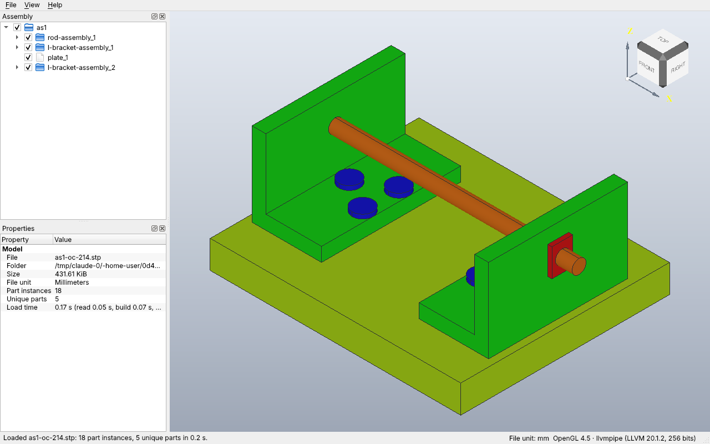
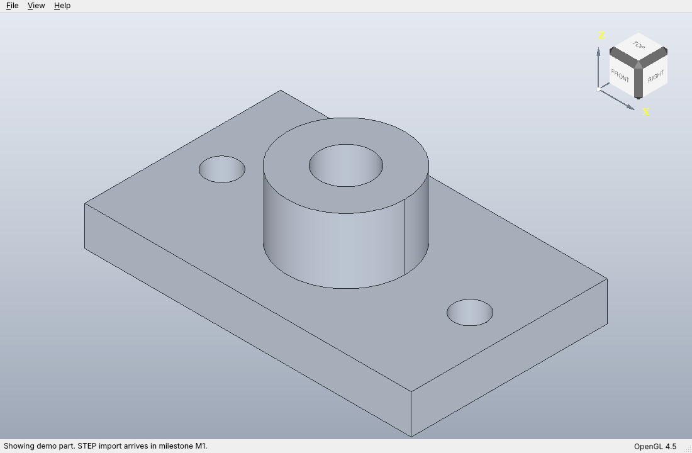
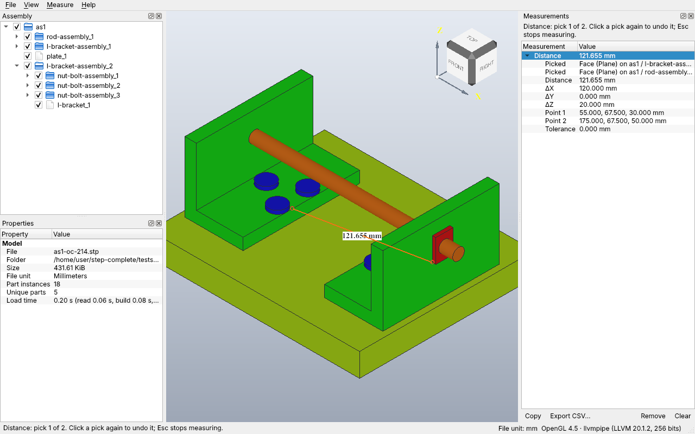
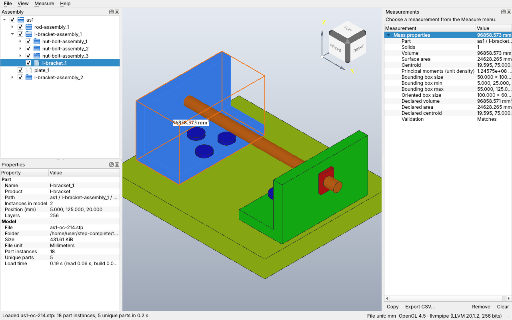
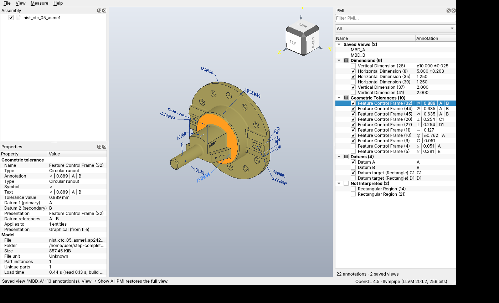
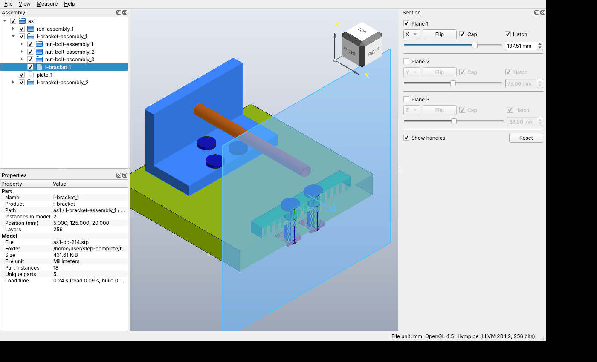

# STEP Complete user guide

STEP Complete (v1.0) is a fast, lightweight viewer for STEP CAD files (AP203, AP214, AP242) with
exact measurement, PMI display (GD&T, dimensions, datums, saved views), section views and image
export. This guide describes what the application does; menu names appear as **Menu > Item**.

Contents: [Installing](#1-installing) | [Requirements](#2-system-requirements) |
[Opening files](#3-opening-files) | [Navigating](#4-navigating-the-3d-view) |
[Assembly and properties](#5-assembly-tree-and-properties) | [Measuring](#6-measuring) |
[PMI](#7-pmi) | [Sections](#8-section-views) | [Export](#9-exporting-images) |
[Preferences](#10-preferences) | [Shortcuts](#11-keyboard-shortcut-reference) |
[Troubleshooting](#12-troubleshooting)



## 1. Installing

This section matches the v1.0 packages. Download the file for your platform from the project's
GitHub releases page. `<version>` is the release number.

| Platform | File |
|---|---|
| Windows (64-bit) | `StepComplete-<version>-windows-x64-setup.exe` (installer) or `StepComplete-<version>-windows-x64.zip` (portable) |
| macOS, Apple Silicon | `StepComplete-<version>-macos-arm64.dmg` |
| macOS, Intel | `StepComplete-<version>-macos-x64.dmg` |
| Linux (x86_64) | `StepComplete-<version>-linux-x86_64.AppImage` |

**Windows.** Run the setup program, or unzip the portable archive anywhere and start the
STEP Complete executable. If SmartScreen warns about an unrecognized app, choose
More info > Run anyway.

**macOS.** Open the DMG and drag STEP Complete to Applications. The app is not signed with an
Apple Developer ID certificate (it is unsigned or ad-hoc signed), so macOS blocks the first
launch. Either:

- right-click (or Control-click) the app and choose **Open**, then confirm; or
- try to open it once, then go to **System Settings > Privacy & Security**, scroll to the
  message about STEP Complete and click **Open Anyway**.

You only need to do this once.

**Linux.** Make the AppImage executable and run it:

```bash
chmod +x StepComplete-<version>-linux-x86_64.AppImage
./StepComplete-<version>-linux-x86_64.AppImage
```

AppImages need FUSE 2 (`libfuse2` on Ubuntu 22.04 and later). If FUSE is not available, run
`./StepComplete-<version>-linux-x86_64.AppImage --appimage-extract-and-run`, or extract once with
`--appimage-extract` and start `squashfs-root/AppRun`.

## 2. System requirements

| Platform | Minimum |
|---|---|
| Windows | 10 (64-bit) |
| macOS | 12 Monterey; Intel and Apple Silicon |
| Linux | glibc 2.35 (Ubuntu 22.04 era); X11, or Wayland through XWayland |
| Graphics | OpenGL 2.1 minimum, 3.3 or newer recommended (macOS: 4.1 core) |

The design target is a 2016 laptop (dual-core CPU, Intel HD 520 integrated graphics, 4 GB RAM).
Any GPU from that era qualifies.

**Software rendering (Linux).** If the GPU driver is missing or broken, start with
`--software-gl`. This makes Mesa's CPU renderer draw the view. It is slower but works almost
anywhere:

```bash
StepComplete --software-gl model.step
```

The option affects Linux only; it has no effect on Windows and macOS.

## 3. Opening files

**Formats.** STEP AP203, AP214 and AP242 files with the extensions `.step`, `.stp` and `.p21`,
plus compressed `.stpz` files (gzip or zip containers).

**Ways to open a file**

- **File > Open...** (`Ctrl+O`). The dialog remembers the last folder.
- **File > Open Recent**. Lists the last 10 files; entries whose file has gone are disabled;
  **Clear Recent Files** empties the list.
- **Drag and drop** one file onto the window. Only a single local file with a STEP extension is
  accepted.
- **Command line:** `StepComplete model.step` opens the file as soon as the 3D view is ready.

While a file loads, a progress dialog shows the stage (reading, building, meshing). Click
**Cancel** to abort; the previously open model stays in place until the new one has loaded
successfully. Only one file loads at a time. **File > Close** (`Ctrl+W`) closes the model.

When loading finishes the status bar reports the number of part instances, unique parts and the
load time, and the model is fitted to the window. The file's length unit is shown at the lower
right ("File unit: mm"). The window title shows the file name.

**Import messages.** Messages from the STEP translator (warnings and errors, with repeat counts)
are collected in the **Import Messages** panel. It is hidden by default; open it with
**View > Panels > Import Messages**. If any warnings or errors occurred, the status bar says so.

**Faster re-opening.** STEP Complete keeps a local cache of processed models in your operating
system's cache folder, so opening the same file again is faster. The cache is safe to delete and
can be turned off in **File > Preferences** (see Preferences > Cache).

## 4. Navigating the 3D view



### Mouse

| Action | Binding |
|---|---|
| Orbit | Left button drag |
| Pan | Middle button drag, or Shift + left drag |
| Zoom | Mouse wheel (zooms toward the cursor), or Ctrl + left drag, or Ctrl + middle drag |
| Select | Left click on a part; click empty space to clear |
| Add to selection | Shift + click |
| Context menu | Right click: Hide, Isolate, Show All, Transparent, Fit Selection |

The right button is not used for navigation. Hovering highlights the entity under the cursor.

### View cube

The cube in the upper right corner shows the current orientation. Click a face, edge or corner
to animate to that view; click the arrows to turn the view in steps. Dragging on the cube rotates
the model.

### View menu

- **Fit All** (`F`) and **Fit Selection** (`Shift+F`).
- **Standard Views:** Front `1`, Back `2`, Top `3`, Bottom `4`, Left `5`, Right `6`,
  Isometric `0`. Z is up; Front looks along +Y.
- **Perspective Projection** (`P`): toggles between orthographic (default) and perspective.
- **Display style:** Shaded (`S`), Shaded with Edges (`E`), Wireframe (`W`).
- **Hide** (`H`), **Isolate** (`I`), **Show All** (`Shift+H`), **Transparent** (`T`), applying to
  the selected parts or assemblies. Transparent toggles 60 percent transparency on or off.
- **Antialiasing (4x MSAA)** and **Show Frame Rate** (a frames-per-second overlay).
- **Panels:** show or hide any dock panel.

Panels can be dragged, tabbed or floated. The PMI, Measurements and Section panels share a tabbed
dock on the right.

## 5. Assembly tree and properties

The **Assembly** panel (upper left) shows the product structure. Assemblies and parts have
different icons.

- **Visibility:** each row has a checkbox. Unchecking an assembly hides everything below it; a
  partially checked box means some children are hidden. Hidden parts are also skipped by mass
  properties.
- **Selection sync:** clicking a row selects the part in 3D, and clicking a part in 3D selects
  and scrolls to its row, expanding collapsed parents. Ctrl or Shift extend the tree selection.
  Selecting an assembly selects every part below it.
- **Hide, Isolate, Show All, Transparent, Fit Selection** are available from the View menu, their
  keys, and the right-click menu in the tree and the 3D view. **Isolate** hides everything except
  the selection.

The **Properties** panel (below the tree) shows details of the current selection:

- *Part* or *Assembly*: name, product name (when different), full path, number of instances in
  the model, children and parts below (assemblies), position (mm), instance color, layers,
  "Hidden in file", and the file's own attributes.
- With several items selected: the count of items and part instances.
- *Model* (always shown): file name, folder, size, file unit, part instances, unique parts and
  load time broken into read, build and mesh.
- When an annotation is selected, its PMI properties replace the part properties (see PMI).

Validation properties (volume, area, centroid declared by the file) are compared with the
computed values by **Measure > Mass Properties**.

## 6. Measuring

Measurements use the exact B-rep geometry of the file, never the display mesh, and work on
transformed instances inside assemblies.



### Modes (Measure menu)

| Mode | Key | Picks | Result |
|---|---|---|---|
| Entity Info | `M` | 1 | Type, size and position of a vertex, edge or face |
| Distance | `D` | 2 | Minimum distance between two entities, plus center and parallel distances where meaningful |
| Point to Point | `Shift+D` | 2 | Distance between two snapped points |
| Angle | `A` | 2 | Angle between straight edges, planar faces or axes (with the supplement) |
| Radius / Diameter | `R` | 1 | Radius and diameter of a circular edge or a cylindrical, spherical or toroidal face |
| Mass Properties | `Shift+M` | none | See below |
| Stop Measuring | `Esc` | | Leaves measure mode |

### Picking

Choose a mode, then click entities in the 3D view. Faces, edges and vertices are all pickable
(which kinds depends on the mode). The hint line at the top of the Measurements panel and the
status bar show progress ("pick 1 of 2"). Clicking a picked entity again un-picks it. After the
last pick the result appears at once, with a witness drawn on top of the model (dimension line,
markers and a label). Measuring continues in the same mode until you press `Esc`. Starting a
measurement clears the part selection, and selecting a PMI annotation leaves measure mode.

**Snapping (Point to Point).** While hovering, a marker and label show where a click will snap:
*Vertex*, *Endpoint*, *Midpoint* and *Center* (circle centers) are preferred when the cursor is
within a few pixels; otherwise the point is the closest point *On Edge* or *On Face* (the exact
clicked point on the surface).

### Mass properties

**Shift+M** measures the selected parts (assemblies expand to their parts), or every visible part
when nothing is selected. Hidden parts are skipped. Results, at unit density: volume, surface
area, centroid, principal moments of inertia, and axis-aligned and oriented bounding boxes. The
witness is the bounding box with a marker at the centroid. When exactly one part carries
validation properties in the file, the declared values are shown next to the computed ones with
the percentage difference and a verdict such as "Matches".



### Measurements panel

Results collect in the **Measurements** panel (right dock). The newest is expanded; selecting a
row redraws its witness in the 3D view. Buttons at the bottom:

- **Copy:** selected results as readable text on the clipboard.
- **Export CSV...:** all results to a CSV file (UTF-8 with byte-order mark, so spreadsheet apps
  show units such as mm2 and degree signs correctly).
- **Remove** (selected) and **Clear** (all).

Results are cleared when a new file is opened.

### Units

Under **Measure** choose **Length Unit** (micrometer, millimeter, centimeter, meter, inch, foot),
**Precision** (0 to 6 decimals; default 3) and **Angle Unit** (degrees or radians). The choice is
remembered. A change applies to new measurements; existing rows keep the text they were measured
with. Values are converted from the file's own unit automatically.

## 7. PMI

Product Manufacturing Information is read from AP242 files: dimensions (with tolerances, limits,
fits), geometric tolerances (feature control frames), datums and datum targets, and saved views.
When a file contains PMI, the **PMI** panel opens automatically (otherwise it is hidden; open it
under **View > Panels > PMI**).



### PMI panel

- The tree groups annotations as **Saved Views**, **Dimensions**, **Geometric Tolerances**,
  **Datums** and **Not Interpreted**. A summary line shows the counts.
- **Filter PMI...** searches names and text; the drop-down restricts to one group.
- Each annotation and group has a checkbox to show or hide it in 3D.
- **Highlighting targets:** selecting an annotation (in the panel or by clicking it in 3D)
  highlights the faces and edges it applies to, on every instance of the part, and shows its full
  details in the **Properties** panel (type, text, values, datum references, number of entities it
  applies to, and whether it is semantic or graphical).
- **Saved views:** double-click (or press Enter on) a saved view to apply it. The camera moves to
  the view the exporting CAD system defined, only the annotations in that view are shown, and
  clipping planes stored in the view are applied. **View > Show All PMI** restores every
  annotation and removes the clipping.

### Semantic and graphical PMI

- **Graphical** PMI is the presentation authored by the CAD system (lines and text, drawn exactly
  as exported).
- **Semantic** PMI is the machine-readable meaning (for example a position tolerance of 0.2 to
  datums A, B). **View > PMI Labels from Semantics** draws semantic annotations as boxed labels
  with leaders, dimension lines and arrows. It is switched on automatically for files where fewer
  than half of the annotations have graphics, and is off otherwise.
- **Not Interpreted** annotations could not be read semantically; they are drawn from their
  graphics and are never hidden.
- Semantic labels are screen-aligned. To keep them readable, overlapping labels are moved apart
  and joined to their anchor by a connector; this re-runs a moment after the camera stops.

### Limits

Some data cannot be recovered from every file or from every OCCT version. For example, graphics
of tessellated annotations are missing in builds that use OCCT 7.6, angular dimensions have no
arc, and some saved views are framed as authored. See [pmi-coverage.md](pmi-coverage.md) for the
supported features and known gaps.

## 8. Section views

**View > Section View** (`X`) cuts the model with up to three planes and opens the **Section**
panel.



For each of Plane 1, 2 and 3:

- Tick **Plane n** to enable it. Turning the section view on enables Plane 1.
- **Axis:** X, Y or Z, the axis the plane is perpendicular to.
- **Flip:** cut away the other side. The side the arrow points to is removed.
- **Slider / spin box:** position along the plane's normal (mm). Planes start at the middle of
  the model.
- **Cap:** fill the cut solids so the section looks closed.
- **Hatch:** hatch the cut faces (needs Cap).

**Show handles** displays a translucent rectangle with an arrow at each enabled plane. Drag a
handle with the left mouse button to move the plane; it highlights on hover. **Reset** turns all
planes off, and so does unchecking **Section View**.

## 9. Exporting images

**File > Export Image...** (`Ctrl+Shift+E`) saves the current 3D view.

1. Choose a file name and type: PNG (default) or JPEG.
2. In the dialog choose the size: **Current view size**, or **Custom size** (up to 8192 x 8192
   px; **Keep aspect ratio** is on by default).
3. Choose the background: **As shown**, **White**, or **Transparent** (PNG only).

The image is rendered off-screen at the chosen size, so it can be larger than the window. The
folder is remembered.

## 10. Preferences

**File > Preferences...** (on macOS it appears in the application menu). Changes preview live;
**OK** saves them, **Cancel** reverts.

| Setting | Options |
|---|---|
| Background | Gradient (choose top and bottom colors), Solid color, or White |
| Lighting | Default, Brighter, Softer |
| Antialiasing | Smooth edges (4x MSAA). Slower on old graphics hardware; off by default. Also available as View > Antialiasing |
| Cache | Enable or disable the local model cache (see Opening files) |

Measurement units and precision are set in the **Measure** menu and are remembered too.
Preferences are stored per user by Qt's settings mechanism (registry on Windows, a plist file on
macOS, a configuration file under `~/.config` on Linux).

## 11. Keyboard shortcut reference

On macOS the `Ctrl` of the standard file shortcuts is the Command key.

| Key | Action |
|---|---|
| `Ctrl+O` | Open file |
| `Ctrl+W` | Close model |
| `Ctrl+Shift+E` | Export image |
| `Ctrl+Q` | Quit |
| `F` | Fit all |
| `Shift+F` | Fit selection |
| `1` `2` `3` `4` `5` `6` | Front, Back, Top, Bottom, Left, Right |
| `0` | Isometric |
| `P` | Toggle perspective projection |
| `S` / `E` / `W` | Shaded / Shaded with edges / Wireframe |
| `H` | Hide selection |
| `I` | Isolate selection |
| `Shift+H` | Show all |
| `T` | Toggle transparency of selection |
| `X` | Toggle section view |
| `M` | Measure: entity info |
| `D` | Measure: distance |
| `Shift+D` | Measure: point to point |
| `A` | Measure: angle |
| `R` | Measure: radius / diameter |
| `Shift+M` | Mass properties |
| `Esc` | Stop measuring |

Mouse: left drag orbit; middle drag or Shift + left drag pan; wheel or Ctrl + left drag zoom;
left click select; Shift + click add to selection; right click context menu.

Menu items without shortcuts: Open Recent, Preferences, Show All PMI, PMI Labels from Semantics,
Antialiasing, Show Frame Rate, Panels, Length Unit, Precision, Angle Unit, Help items.

## 12. Troubleshooting

**The 3D view is black, blank or shows a "Graphics Error".** Update your GPU driver first. On
Linux, start with `--software-gl`. Check **Help > Graphics Information...** to see what the
driver reports (renderer, OpenGL version); OpenGL 2.1 or newer is required.

**Linux with Wayland.** STEP Complete runs through XWayland automatically because OCCT's Linux
renderer uses GLX. Make sure XWayland is installed. Setting `QT_QPA_PLATFORM` yourself overrides
this choice.

**Large files.** Loading shows progress and can be cancelled. Hiding parts and turning off
semantic PMI labels or antialiasing helps on slow machines. Opening the same file again is faster
thanks to the cache. A 50 MB file is expected to need under 2 GB of RAM while loading.

**Measurements look wrong.** Check the length unit and precision in the Measure menu; the file's
unit is shown at the lower right of the window.

**Parts or PMI are missing.** Open the Import Messages panel (View > Panels). Items hidden in the
file show "Hidden in file" in Properties; **View > Show All** reveals parts you hid.

**Where things live.** Settings: Qt's per-user settings store (see Preferences). Cache: your
operating system's per-user cache folder, in a STEP Complete subfolder (for example under
`~/.cache` on Linux). You can delete it at any time.

**Reporting a bug.** Open **Help > About STEP Complete > System info** and click **Copy**, then
paste the text into a new issue at <https://github.com/brsnell/step-complete/issues> along with
the steps to reproduce and, if you can share it, the STEP file. **Help > Graphics Information...**
has a Copy button too and is useful for display problems.
