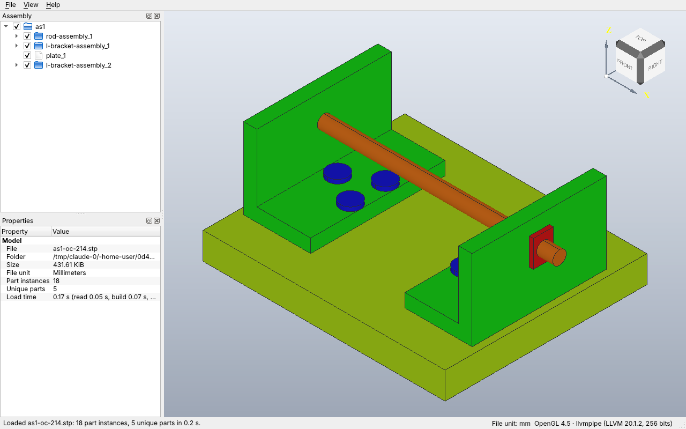
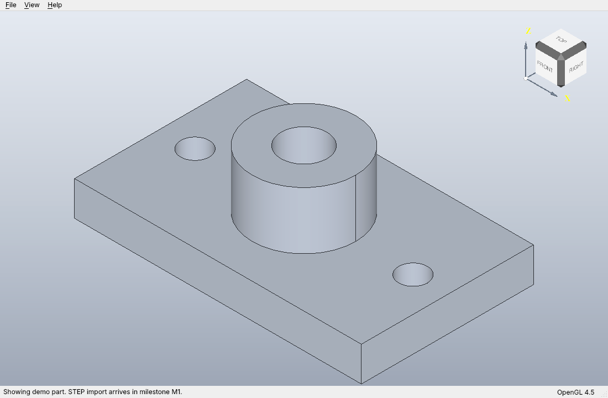
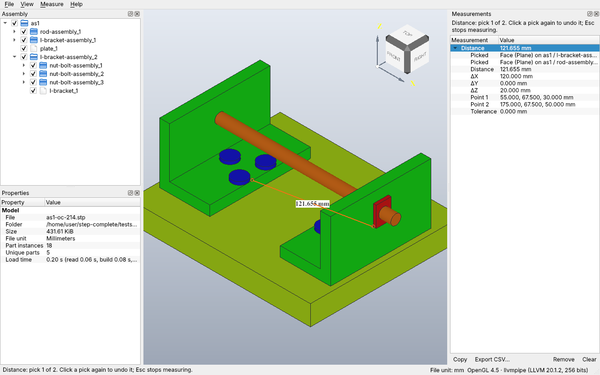
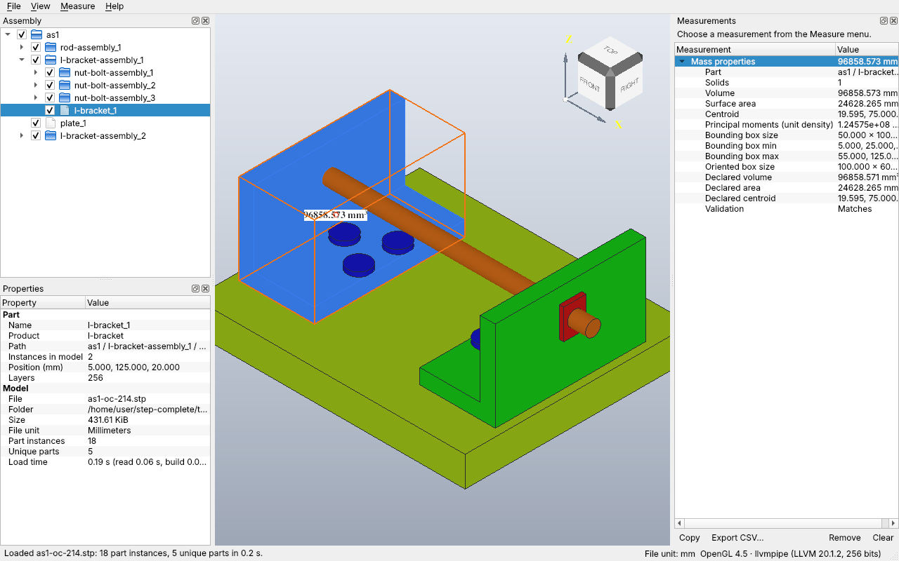
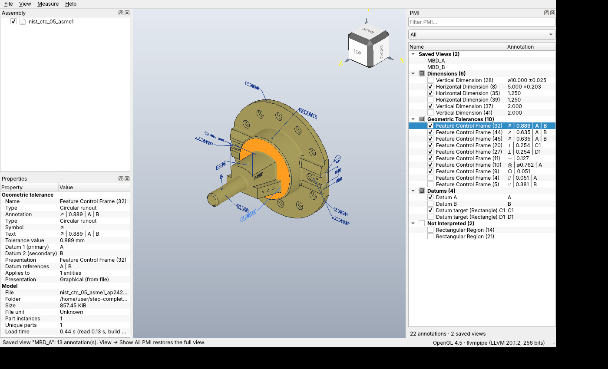
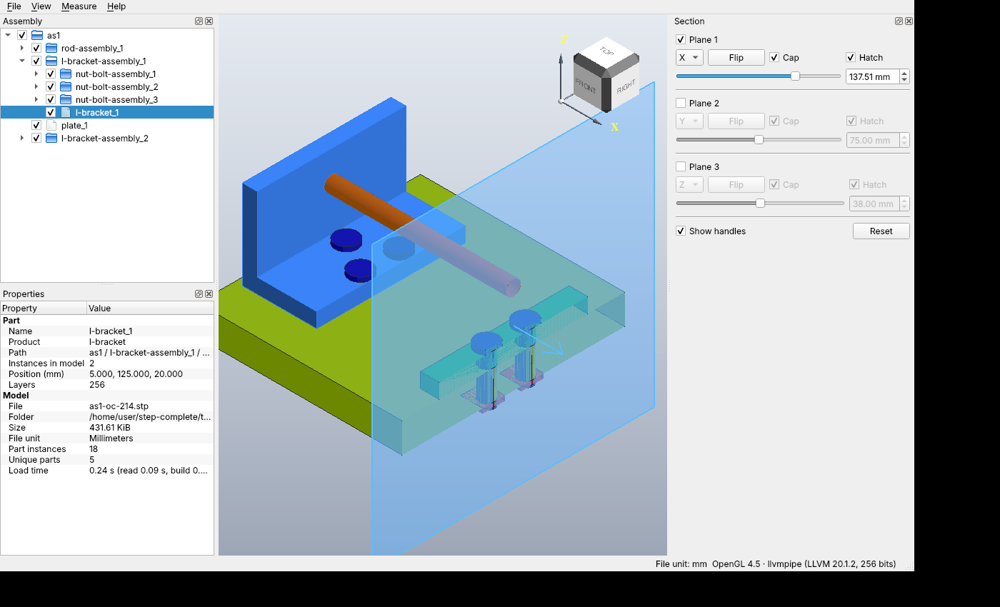

# STEP Complete user guide

STEP Complete (v1.4) is a fast, lightweight viewer for STEP CAD files (AP203, AP214, AP242) with
exact measurement, PMI display (GD&T, dimensions, datums, saved views), section views, and image
and geometry export. This guide describes what the application does; menu names appear as **Menu > Item**.

Contents: [Installing](#1-installing) | [Requirements](#2-system-requirements) |
[Opening files](#3-opening-files) | [Navigating](#4-navigating-the-3d-view) |
[Assembly and properties](#5-assembly-tree-and-properties) | [Measuring](#6-measuring) |
[PMI](#7-pmi) | [Sections](#8-section-views) | [Export](#9-exporting) | [Markup](#10-markup) |
[Preferences](#11-preferences) | [Shortcuts](#12-keyboard-shortcut-reference) |
[Troubleshooting](#13-troubleshooting)



## 1. Installing

This section matches the v1.3 packages. Download the file for your platform from the project's
GitHub releases page. `<version>` is the release number.

| Platform | File |
|---|---|
| Windows (64-bit) | `StepComplete-<version>-windows-x64-setup.exe` (installer) or `StepComplete-<version>-windows-x64-portable.zip` (portable) |
| Linux (x86_64) | `StepComplete-<version>-x86_64.AppImage` |
| macOS, Apple Silicon | `StepComplete-<version>-macos-arm64.dmg` (not published yet) |
| macOS, Intel | `StepComplete-<version>-macos-x64.dmg` (not published yet) |

Releases so far ship for Windows and Linux only. The macOS packages will be added in a later release,
once they have been tested on a Mac; the macOS instructions below apply from then on.

**Windows.** Run the setup program, or unzip the portable archive anywhere and start the
STEP Complete executable. If SmartScreen warns about an unrecognized app, choose
More info > Run anyway.

**macOS.** Open the DMG and drag STEP Complete to Applications. The app is not signed with an
Apple Developer ID certificate (it is unsigned or ad-hoc signed), so macOS blocks the first
launch. Either:

- right-click (or Control-click) the app and choose **Open**, then confirm; or
- try to open it once, then go to **System Settings > Privacy & Security**, scroll to the
  message about STEP Complete and click **Open Anyway**.

You only need to do this once.

**Linux.** Make the AppImage executable and run it:

```bash
chmod +x StepComplete-<version>-x86_64.AppImage
./StepComplete-<version>-x86_64.AppImage
```

AppImages need FUSE 2 (`libfuse2` on Ubuntu 22.04 and later). If FUSE is not available, run
`./StepComplete-<version>-x86_64.AppImage --appimage-extract-and-run`, or extract once with
`--appimage-extract` and start `squashfs-root/AppRun`.

## 2. System requirements

| Platform | Minimum |
|---|---|
| Windows | 10 (64-bit) |
| macOS | 12 Monterey; Intel and Apple Silicon |
| Linux | glibc 2.35 (Ubuntu 22.04 era); X11, or Wayland through XWayland |
| Graphics | OpenGL 2.1 minimum, 3.3 or newer recommended (macOS: 4.1 core) |

The design target is a 2016 laptop (dual-core CPU, Intel HD 520 integrated graphics, 4 GB RAM).
Any GPU from that era qualifies.

**Software rendering (Linux).** If the GPU driver is missing or broken, start with
`--software-gl`. This makes Mesa's CPU renderer draw the view. It is slower but works almost
anywhere:

```bash
StepComplete --software-gl model.step
```

The option affects Linux only; it has no effect on Windows and macOS.

## 3. Opening files

**Formats.** STEP AP203, AP214 and AP242 files with the extensions `.step`, `.stp` and `.p21`,
plus compressed `.stpz` files (gzip or zip containers), and IGES files (`.igs`, `.iges`). The
content decides: a STEP file with an IGES name (or the reverse) opens as what it is, and
Properties shows the **Format**. IGES has no assembly structure, so its parts sit at the top of
the Assembly tree with their names, colors and layers; it has no PMI or saved views.

**Mesh files.** STL (`.stl`, ASCII or binary), OBJ (`.obj`, with the colors of its `.mtl` file)
and glTF 2.0 (`.gltf`, `.glb`, with names, colors and the node hierarchy) open too. A mesh is
triangles only, with no exact faces, edges or circles, so:

- **Measure > Distance, Point to Point, Angle, Radius and Entity Info**, **Check Geometry** and
  **Check Clashes** are off for a mesh file; the status bar says so when the file opens.
- **Mass Properties** come from the triangles: area always, and volume, centroid and inertia
  that are exact for a closed mesh (the result says "From: mesh"). Materials, mass and the parts
  list work as for solids.
- Display, the Assembly tree, hiding and transparency, sections, **Wall Thickness**, saved views
  and the exports all work as usual.
- **Units and axes.** glTF is in metres with Y up by its specification, so it is scaled to
  millimetres and turned Z up. STL and OBJ have no unit: millimetres are assumed (the file unit
  reads "mm (assumed)"). STL stays as written (Z up); OBJ is read as Y up, like most tools and
  this app's own OBJ export write it.

**Ways to open a file**

- **File > Open...** (`Ctrl+O`). The dialog remembers the last folder.
- **File > Open Recent**. Lists the last 10 files; entries whose file has gone are disabled;
  **Clear Recent Files** empties the list.
- **Drag and drop** one file onto the window. Only a single local file with a STEP, IGES or mesh extension is
  accepted.
- **Command line:** `StepComplete model.step` opens the file as soon as the 3D view is ready.

While a file loads, a progress dialog shows the stage (reading, building, meshing). Click
**Cancel** to abort; the previously open model stays in place until the new one has loaded
successfully. Only one file loads at a time. **File > Close** (`Ctrl+W`) closes the model.

When loading finishes the status bar reports the number of part instances, unique parts and the
load time, and the model is fitted to the window. The file's length unit is shown at the lower
right ("File unit: mm"). The window title shows the file name.

**Import messages.** Messages from the STEP or IGES translator (warnings and errors, with repeat counts)
are collected in the **Import Messages** panel. It is hidden by default; open it with
**View > Panels > Import Messages**. If any warnings or errors occurred, the status bar says so.

**Faster re-opening.** STEP Complete keeps a local cache of processed models in your operating
system's cache folder, so opening the same file again is faster. The cache is safe to delete and
can be turned off in **File > Preferences** (see Preferences > Cache).

## 4. Navigating the 3D view



### Mouse

| Action | Binding |
|---|---|
| Orbit | Left button drag |
| Pan | Middle button drag, or Shift + left drag |
| Zoom | Mouse wheel (zooms toward the cursor), or Ctrl + left drag, or Ctrl + middle drag |
| Select | Left click on a part; click empty space to clear |
| Add to selection | Shift + click |
| Context menu | Right click: Hide, Isolate, Show All, Transparent, Fit Selection |

The right button is not used for navigation. Hovering highlights the entity under the cursor.

### View cube

The cube in the upper right corner shows the current orientation. Click a face, edge or corner
to animate to that view; click the arrows to turn the view in steps. Dragging on the cube rotates
the model.

### View menu

- **Fit All** (`F`) and **Fit Selection** (`Shift+F`).
- **Standard Views:** Front `1`, Back `2`, Top `3`, Bottom `4`, Left `5`, Right `6`,
  Isometric `0`. Z is up; Front looks along +Y.
- **Perspective Projection** (`P`): toggles between orthographic (default) and perspective.
- **Saved Views:** your own views of the model.
  - **Save Current View...** (`Ctrl+Shift+V`) stores the camera, which parts are hidden and the
    section planes under a name ("View 1" by default; the same name replaces that view).
  - Choosing a saved view from the list brings all three back. Display style, transparency and
    PMI are not part of a saved view.
  - **Manage Saved Views...** renames (edit the name in place), deletes and reorders them.

  Views belong to the file's content and are kept in STEP Complete's data folder, not next to
  the model: they come back whenever the same file is opened, even after it is copied, renamed or
  moved. A file re-exported in place keeps its views; parts that no longer exist are skipped.
  The views a STEP file's PMI declares are in the PMI panel (section 7).
- **Display style:** Shaded (`S`), Shaded with Edges (`E`), Wireframe (`W`), Hidden Line (`L`).
  Hidden Line draws the faces in white with the sharp edges and outlines in dark lines, like a
  drawing; edges behind faces are hidden. Selected parts still light up in the selection color,
  and section caps are white (hatched if Hatch is on).
- **Hide** (`H`), **Isolate** (`I`), **Show All** (`Shift+H`), **Transparent** (`T`), applying to
  the selected parts or assemblies. Transparent toggles 60 percent transparency on or off.
- **Antialiasing (4x MSAA)** and **Show Frame Rate** (a frames-per-second overlay).
- **Panels:** show or hide any dock panel.

Panels can be dragged, tabbed or floated. The PMI, Measurements and Section panels share a tabbed
dock on the right.

## 5. Assembly tree and properties

The **Assembly** panel (upper left) shows the product structure. Assemblies and parts have
different icons.

- **Visibility:** each row has a checkbox. Unchecking an assembly hides everything below it; a
  partially checked box means some children are hidden. Hidden parts are also skipped by mass
  properties.
- **Selection sync:** clicking a row selects the part in 3D, and clicking a part in 3D selects
  and scrolls to its row, expanding collapsed parents. Ctrl or Shift extend the tree selection.
  Selecting an assembly selects every part below it.
- **Filter parts:** type in the box above the tree (**View > Find Part...**, `Ctrl+F`) to show only
  the parts and assemblies whose name or product name contains the text, ignoring case. The
  assemblies on the way to each match stay, expanded to show it, and everything below a matching
  assembly stays too. A selected row that the filter hides is deselected in 3D as well. Clear the
  box (or open another file) to see the whole tree again.
- **Hide, Isolate, Show All, Transparent, Fit Selection** are available from the View menu, their
  keys, and the right-click menu in the tree and the 3D view. **Isolate** hides everything except
  the selection.

The **Properties** panel (below the tree) shows details of the current selection:

- *Part* or *Assembly*: name, product name (when different), full path, number of instances in
  the model, children and parts below (assemblies), position (mm), instance color, layers,
  "Hidden in file", and the file's own attributes.
- With several items selected: the count of items and part instances.
- *Model* (always shown): file name, folder, size, file unit, part instances, unique parts and
  load time broken into read, build and mesh.
- When an annotation is selected, its PMI properties replace the part properties (see PMI).

Validation properties (volume, area, centroid declared by the file) are compared with the
computed values by **Measure > Mass Properties**.

## 6. Measuring

Measurements use the exact B-rep geometry of the file, never the display mesh, and work on
transformed instances inside assemblies.



### Modes (Measure menu)

| Mode | Key | Picks | Result |
|---|---|---|---|
| Entity Info | `M` | 1 | Type, size and position of a vertex, edge or face |
| Distance | `D` | 2 | Minimum distance between two entities, plus center and parallel distances where meaningful |
| Point to Point | `Shift+D` | 2 | Distance between two snapped points |
| Angle | `A` | 2 | Angle between straight edges, planar faces or axes (with the supplement) |
| Radius / Diameter | `R` | 1 | Radius and diameter of a circular edge or a cylindrical, spherical or toroidal face |
| Mass Properties | `Shift+M` | none | See below |
| Stop Measuring | `Esc` | | Leaves measure mode |

### Picking

Choose a mode, then click entities in the 3D view. Faces, edges and vertices are all pickable
(which kinds depends on the mode). The hint line at the top of the Measurements panel and the
status bar show progress ("pick 1 of 2"). Clicking a picked entity again un-picks it. After the
last pick the result appears at once, with a witness drawn on top of the model (dimension line,
markers and a label). Measuring continues in the same mode until you press `Esc`; the results
and their witnesses stay when you stop. Starting a measurement clears the part selection, and
selecting a PMI annotation leaves measure mode.

**Snapping (Point to Point).** While hovering, a marker and label show where a click will snap:
*Vertex*, *Endpoint*, *Midpoint* and *Center* (circle centers) are preferred when the cursor is
within a few pixels; otherwise the point is the closest point *On Edge* or *On Face* (the exact
clicked point on the surface).

### Mass properties

**Shift+M** measures the selected parts (assemblies expand to their parts), or every visible part
when nothing is selected. Hidden parts are skipped. Results: volume, surface area, centroid,
principal moments of inertia, and axis-aligned and oriented bounding boxes. The witness is the
bounding box with a marker at the centroid.

**Mass.** Give parts a material with **Measure > Set Material...**: pick one from the list (steel,
aluminium, ABS and others, with typical densities) or type a name and a density in kg/m³. It
applies to every instance of the selected parts. **Clear Material** removes it. A material the
STEP file declares is used when you have not set one; the Properties panel shows each part's
material and where it comes from. When every measured part has a material, mass properties
report the **mass** (the headline), the **center of mass** and the principal moments of inertia
in mass units, each part with its own density. If some parts have no material, the result stays
at unit density and says how many lack one. Materials are kept per file, like saved views. When exactly one part carries
validation properties in the file, the declared values are shown next to the computed ones with
the percentage difference and a verdict such as "Matches".



### Measurements panel

Results collect in the **Measurements** panel (right dock), which opens when a new result
arrives. The newest is expanded; older results keep whatever you expanded, so several can be
compared.

Each successful result has a checkbox, and new results start checked. Every checked result's
witness is drawn in the 3D view at once: the selected result is emphasized in full orange, the
others are thinner and paler. Closing the Measurements panel hides the witnesses; reopening it
shows them again.

Buttons at the bottom:

- **Copy:** selected results as readable text on the clipboard.
- **Export CSV...:** all results to a CSV file (UTF-8 with byte-order mark, so spreadsheet apps
  show units such as mm2 and degree signs correctly).
- **Show All / Hide All:** checks or unchecks every result. It reads **Hide All** while any
  result is shown.
- **Remove** (the selected results, or the current one when none is selected) and **Clear**
  (all). `Delete` in the list also removes the selected results (`Backspace` too on macOS).

Right-clicking the list opens a menu with **Copy**, **Remove**, **Show in 3D View**, **Show All**,
**Hide All** and **Clear All**. Right-clicking a row that is not selected acts on that row alone.

Results and their witnesses are cleared when another file is opened or the model is closed.

### Geometry check

**Measure > Check Geometry** looks for bad geometry in the selected parts (assemblies expand to
their parts), or in every visible part when nothing is selected. Each part definition is checked
once, however many instances it has. It runs in the background: the **Geometry Check** panel
(bottom dock, next to Import Messages) shows the progress and a **Cancel** button. It reports:

- **Invalid geometry:** OCCT's full shape check, such as a self-intersecting wire, a curve that
  does not lie on its face or a face without a surface. The detail names the problem.
- **Open shell:** a solid whose shell has free edges, so it has a gap and its volume and mass are
  wrong. The highlight is the edges around the gap. Sheet bodies (shells that are not solids)
  are open on purpose and are not reported.
- **Tiny edge:** an edge shorter than 0.001 mm (degenerate edges, such as the pole of a sphere,
  do not count). Such edges break meshing and picking.

The summary says "No problems found in 12 parts." or "7 problems in 2 of 12 parts.", and the
status bar repeats it. Each row lists the part (with ×N when N instances share it), the kind of
problem and the detail. Selecting a row draws the faulty face, edge or vertex in red on top of
the model; double-clicking zooms to it. A part lists at most 200 problems, but the summary counts
them all. **Check Again** reruns the check on the current selection. Closing the panel hides the
highlight; opening another file or closing the model clears the panel.

### Clash check

**Measure > Check Clashes...** finds parts that collide, among the selected parts (assemblies
expand to their parts) or every visible part when nothing is selected. Each instance counts on
its own, so two copies of the same bolt can clash. A dialog asks what to report besides
**interference** (parts that share a volume), which is always reported:

- **Also report parts that touch:** faces in contact without overlapping. Seated parts touch
  everywhere in a real assembly, so this is off by default.
- **Also report gaps smaller than** _x_ mm: pairs closer than the clearance that neither overlap
  nor touch.

The choices are remembered. The check runs in the background in the **Clashes** panel (bottom
dock), with progress and **Cancel**; only pairs whose bounding boxes meet are checked exactly, so
large assemblies stay quick. The summary reads, for example, "3 interferences, 1 touching pair
among 45 parts (120 pairs checked)." Each row lists both parts (hover for the full path), the
kind, and the overlap volume or the gap in the Measure menu's length unit. Interferences come
first, largest overlap first, then touching pairs, then gaps, smallest first. A pair OCCT could
not check is listed as "Could not be checked".

Choosing a row selects both parts and draws the overlap in red (for a gap, the line between the
closest points; for touching parts, the contact points). Double-clicking zooms to the pair.
**Check Again** repeats the last check with the same parts and options, even after choosing a row
has changed the selection. At most 2,000 rows are listed; the summary counts every clash.
Opening another file or closing the model clears the panel.

### Wall thickness

**Measure > Wall Thickness** colors the selected parts (assemblies expand to their parts), or every
visible part when nothing is selected, by their local wall thickness: red at or below the **thin
limit**, through yellow and green, to blue at or above the **thick limit**. A legend in the
lower-left corner of the 3D view shows the scale in the Measure menu's length unit. Hovering over
a colored part shows the thickness under the cursor. Choose the menu item again to go back to the
normal display.

The thickness at a point is measured straight into the part, along the surface normal, to where
it comes out the other side (the "ray method"). It is measured on the display mesh, refined so
large flat faces get enough points, so it is accurate to about the mesh deflection. Measuring runs
in the background with progress and **Cancel** in the **Wall Thickness** panel (right dock). The
panel shows the range found and the two limits, which recolor at once when changed; **Reset**
goes back to the range found. The range leaves out the most extreme 0.1% of points at each end,
because single points at sharp corners of curved faces can read far off.

- Sheets (faces with no solid behind them) have no wall and keep their own look.
- Grey areas found no wall behind them, usually where the file's mesh has a gap; the panel says
  how much of the surface that is.
- Selecting, hiding, isolating and section views keep working on colored parts. Measuring needs
  the parts' own faces and edges, so starting a measurement turns the view off.

### Comparing revisions

**File > Compare With...** opens another revision of the open model and shows what changed. The
two files must place the model the same way (two exports from one CAD model do). The open model
is colored part by part:

- **Changed** parts by their deviation from the other revision: green within the tolerance, then
  towards red where the open model has material the other has not, and towards blue where it
  lost material. A legend shows the scale in the Measure menu's length unit.
- **Moved** parts (the same geometry somewhere else) in purple, **added** parts (only in the open
  model) in orange and **unchanged** parts in light grey.
- **Removed** parts (only in the other revision) appear as red see-through ghosts where they were.

The **Comparison** panel (bottom dock) gives a summary ("Compared with rev-b.step: 3 changed,
1 moved, 1 added, 2 removed, 40 unchanged.") and lists every part that differs, with its change
and largest deviation; **Show unchanged** lists the rest too. Choosing a row selects the part
(a selected colored part shows its bounding box); double-clicking zooms to it, or to a removed
part's ghost. The **Tolerance** (0.01 mm by default) decides what counts as equal: change it and
click **Compare Again**. **End Comparison** brings back the normal display; opening another file,
closing the model, starting a measurement or turning on Wall Thickness ends it too.

Parts pair by their place in the assembly tree; parts that were renamed pair by their shape, then
by name ("nut_2" and "NUT"). Unchanged, moved or changed is decided on the exact geometry (volume,
area, centre of mass and inertia), so re-exported identical parts never show as changed; the
deviation colors are measured on the display mesh and are accurate to about the mesh deflection.
Comparing runs in the background with progress and **Cancel**.

### Units

Under **Measure** choose **Length Unit** (micrometer, millimeter, centimeter, meter, inch, foot),
**Mass Unit** (grams, kilograms or pounds; default kilograms), **Precision** (0 to 6 decimals;
default 3) and **Angle Unit** (degrees or radians). The choice is
remembered. A change applies to new measurements; existing rows keep the text they were measured
with. Values are converted from the file's own unit automatically.

## 7. PMI

Product Manufacturing Information is read from AP242 files: dimensions (with tolerances, limits,
fits), geometric tolerances (feature control frames), datums and datum targets, and saved views.
When a file contains PMI, the **PMI** panel opens automatically (otherwise it is hidden; open it
under **View > Panels > PMI**).



### PMI panel

- The tree groups annotations as **Saved Views**, **Dimensions**, **Geometric Tolerances**,
  **Datums** and **Not Interpreted**. A summary line shows the counts.
- **Filter PMI...** searches names and text; the drop-down restricts to one group.
- Each annotation and group has a checkbox to show or hide it in 3D.
- **Highlighting targets:** selecting an annotation (in the panel or by clicking it in 3D)
  highlights the faces and edges it applies to, on every instance of the part, and shows its full
  details in the **Properties** panel (type, text, values, datum references, number of entities it
  applies to, and whether it is semantic or graphical).
- **Saved views:** double-click (or press Enter on) a saved view to apply it. The camera moves to
  the view the exporting CAD system defined, only the annotations in that view are shown, and
  clipping planes stored in the view are applied. **View > Show All PMI** restores every
  annotation and removes the clipping.

### Semantic and graphical PMI

- **Graphical** PMI is the presentation authored by the CAD system (lines and text, drawn exactly
  as exported).
- **Semantic** PMI is the machine-readable meaning (for example a position tolerance of 0.2 to
  datums A, B). **View > PMI Labels from Semantics** draws semantic annotations as boxed labels
  with leaders, dimension lines and arrows. It is switched on automatically for files where fewer
  than half of the annotations have graphics, and is off otherwise.
- **Not Interpreted** annotations could not be read semantically; they are drawn from their
  graphics and are never hidden.
- Semantic labels are screen-aligned. To keep them readable, overlapping labels are moved apart
  and joined to their anchor by a connector; this re-runs a moment after the camera stops.

### Limits

Some data cannot be recovered from every file or from every OCCT version. For example, graphics
of tessellated annotations are missing in builds that use OCCT 7.6, angular dimensions have no
arc, and some saved views are framed as authored. See [pmi-coverage.md](pmi-coverage.md) for the
supported features and known gaps.

## 8. Section views

**View > Section View** (`X`) cuts the model with up to three planes and opens the **Section**
panel.



For each of Plane 1, 2 and 3:

- Tick **Plane n** to enable it. Turning the section view on enables Plane 1.
- **Axis:** X, Y or Z, the axis the plane is perpendicular to, or **Custom** for any direction.
  Custom shows **X**, **Y** and **Z** fields for the direction the plane faces; any length works
  (it is normalized), and all zeros is refused.
- **Pick Face:** click it, then click a flat face in the 3D view. The plane turns on and lies
  exactly on that face, facing out of the part, so nothing of that part is cut yet: move the
  plane back with the slider or its handle to cut into it, or **Flip** to cut the other side. A
  click on a curved face or empty space keeps waiting; **Esc**, clicking **Pick Face** again or
  starting a measurement cancels. Picking stops any measurement in progress and leaves the
  selection as it was.
- **Flip:** cut away the other side. The side the arrow points to is removed.
- **Slider / spin box:** position along the plane's normal (mm). Planes start at the middle of
  the model.
- **Cap:** fill the cut solids so the section looks closed.
- **Hatch:** hatch the cut faces (needs Cap).

**Show handles** displays a translucent rectangle with an arrow at each enabled plane. Drag a
handle with the left mouse button to move the plane; it highlights on hover. **Reset** turns all
planes off, and so does unchecking **Section View**.

### Exploded view

**View > Exploded View** (`Shift+E`) moves the parts of an assembly apart and opens the
**Exploded View** panel. Each part moves away from the center of the assembly it belongs to, and
each sub-assembly moves as a unit while its own parts spread around it. A part that sits on its
assembly's center (a shaft in a housing) stays where it is.

- **Distance:** 0 to 100 %. At 100 % every part is twice as far from its assembly's center as in
  the assembled model. The parts move as you drag; moving the slider also turns the exploded
  view on.
- **Collapse** (or unchecking **Exploded View**) puts the parts back.

PMI and markup on a part move with it. Selecting, hiding, isolating, transparency, Fit and image
export work as usual. The explode is not saved and does not change exported geometry.

Measuring, the section view, wall thickness, comparing revisions, the Geometry Check and Clashes
highlights, placing a note, sketching and the file's saved views all work on the assembled model:
starting one of them collapses the exploded view first, and exploding turns them off (the
Measurements panel keeps its results, which are drawn again on collapse). The menu item is
disabled when the model has nothing to move apart (a single part or a mesh file).

## 9. Exporting

### Images

**File > Export Image...** (`Ctrl+Shift+E`) saves the current 3D view.

1. Choose a file name and type: PNG (default) or JPEG.
2. In the dialog choose the size: **Current view size**, or **Custom size** (up to 8192 x 8192
   px; **Keep aspect ratio** is on by default).
3. Choose the background: **As shown**, **White**, or **Transparent** (PNG only).

The image is rendered off-screen at the chosen size, so it can be larger than the window. The
folder is remembered.

### Geometry (STL, OBJ, glTF)

**File > Export Geometry...** saves part meshes for 3D printing, other tools or the web. STEP
Complete never writes STEP files.

1. Choose the **Format**:
   - **STL, one file**: every part in place in one binary STL, for printing the assembly.
   - **STL, one file per part**: one STL per unique part, in the part's own coordinates. A bolt
     used 20 times gives one `bolt.stl`. You choose a folder; files are named after the parts,
     and files with the same names in that folder are replaced.
   - **OBJ (with colors)**: an `.obj` and an `.mtl` file with the part and face colors.
   - **glTF** (`.gltf` + `.bin`) or **GLB** (one file): colors, transparency and the assembly
     structure, for web viewers and 3D tools. Repeated parts share one mesh, so files stay small.
2. Choose the **Mesh quality**:
   - **As displayed**: the meshes the viewer shows. Fast.
   - **Fine** and **Extra fine**: smoother curved surfaces (4 and 10 times closer to the exact
     surface than the display). The model is copied and meshed again, which takes longer and
     uses more memory while the export runs; the open model is not changed.
   - **Custom**: a **Tolerance** (the largest gap between the mesh and the exact surface, in
     the export unit) and an **Angle**.
3. Choose the **Unit** for STL and OBJ (millimetres by default, which slicers expect). glTF is
   always in metres.
4. For OBJ choose the **Up axis**: **Y up** (default, what Blender and game engines expect) or
   **Z up** as in the STEP file. STL keeps the model's Z up; glTF is always Y up.
5. Choose the **Parts**: the **Visible parts** (hidden parts are left out), or the **Selected
   parts**.
6. Click **Export...** and choose the file (or the folder, for one STL per part).

A progress dialog with **Cancel** shows while the file is written. When it finishes, the status
bar shows the file and its size. A cancelled or failed export leaves no partial files. Section
views do not cut the export: parts are written whole. PMI, edges and measurements are not
exported. The dialog remembers its choices.

### Parts list (BOM)

**File > Export Parts List...** saves a bill of materials as a CSV file that opens in any
spreadsheet.

1. Choose the **Parts**: **All parts**, or **Visible parts only** (hidden parts, including those the
   file hides, are left out).
2. Choose the optional **Columns**: **Volume**, **Material and mass**, and **Size (bounding box)**.
3. Click **Export...** and choose the file.

There is one row per unique part, in the order the parts appear in the Assembly tree:
- **Item** and **Quantity** (how many instances).
- **Part** (the product name) and **Instance names** (instance names that differ from it).
- **Used in** (the assemblies the part sits in).
- One column per attribute the file declares, such as Part number or Revision.
- With the optional columns: **Material used** and its **Density**, **Volume each**, **Mass each**
  and **Mass total** (from each part's material, see Mass properties in section 6), and
  **Size X/Y/Z** (the part's own bounding box).

A **Total** row ends the list. It gives the total quantity, and the total mass when every part
has a material. Units follow the Measure menu's length and mass units and precision, and the
headers name them. Text from the file that a spreadsheet would treat as a formula (starting with
`=`, `+`, `-` or `@`) is written with a leading apostrophe, so it shows as text.

## 10. Markup

Review notes and sketches pinned to the model. They are never written into the model file: they
are kept with STEP Complete's own data for that file (like saved views), so they come back
whenever the same file is opened again, also after it was copied, renamed or re-exported in
place.

- **Markup > Add Note** (`Ctrl+Shift+N`): click a face, then type the note (several lines are
  fine). The text appears in a yellow box next to the point, joined to it by a leader. `Esc`
  cancels the click. Adding a note stops measuring and turns off the wall thickness and
  comparison views, whose colored parts have no faces to click.
- **Markup > Sketch** (`Ctrl+Shift+K`): while it is on, dragging with the left mouse button
  draws a magenta line over the model. The stroke lies on a plane facing you through the point
  where the drag started (seen from another side it is a flat line in space) and moves with that
  part. The wheel, the middle
  button and `Shift`/`Ctrl` dragging still move the view. Choose Sketch again or press `Esc` to
  stop.
- **Markup > Show Markup** shows or hides every note and stroke. A note or stroke on a hidden part
  is hidden with it.

The **Markup** panel lists the notes (their first line) and the sketches. Choosing a row draws
that item in orange; double-clicking a note edits its text, double-clicking a sketch zooms to
it; **Delete** (or the `Delete` key) removes the chosen rows. **Markup > Delete All Markup...**
removes everything after asking.

**File > Export Image** includes the markup that is shown.

**Sharing.** **Markup > Export Markup...** saves the notes and sketches as a `.scmarkup` file;
**Import Markup...** adds such a file's markup to the open model's (it asks first when the file
was made for a model with another name). Markup is attached to parts by their place in the
model, so it only lands where it should on the same model or a revision of it; items whose part
the open model does not have are listed as "(part missing)" and not drawn.

## 11. Preferences

**File > Preferences...** (on macOS it appears in the application menu). Changes preview live;
**OK** saves them, **Cancel** reverts.

| Setting | Options |
|---|---|
| Background | Gradient (choose top and bottom colors), Solid color, or White |
| Lighting | Default, Brighter, Softer |
| Antialiasing | Smooth edges (4x MSAA). Slower on old graphics hardware; off by default. Also available as View > Antialiasing |
| Cache | Enable or disable the local model cache (see Opening files) |

Measurement units and precision are set in the **Measure** menu and are remembered too.
Preferences are stored per user by Qt's settings mechanism (registry on Windows, a plist file on
macOS, a configuration file under `~/.config` on Linux).

## 12. Keyboard shortcut reference

On macOS the `Ctrl` of the standard file shortcuts is the Command key.

| Key | Action |
|---|---|
| `Ctrl+O` | Open file |
| `Ctrl+W` | Close model |
| `Ctrl+Shift+E` | Export image |
| `Ctrl+Shift+V` | Save the current view (View > Saved Views) |
| `Ctrl+Shift+N` | Add a note (Markup menu) |
| `Ctrl+Shift+K` | Sketch on or off (Markup menu) |
| `Ctrl+Q` | Quit |
| `Ctrl+F` | Find part (filter the Assembly tree) |
| `F` | Fit all |
| `Shift+F` | Fit selection |
| `1` `2` `3` `4` `5` `6` | Front, Back, Top, Bottom, Left, Right |
| `0` | Isometric |
| `P` | Toggle perspective projection |
| `S` / `E` / `W` / `L` | Shaded / Shaded with edges / Wireframe / Hidden line |
| `H` | Hide selection |
| `I` | Isolate selection |
| `Shift+H` | Show all |
| `T` | Toggle transparency of selection |
| `X` | Toggle section view |
| `Shift+E` | Toggle exploded view |
| `M` | Measure: entity info |
| `D` | Measure: distance |
| `Shift+D` | Measure: point to point |
| `A` | Measure: angle |
| `R` | Measure: radius / diameter |
| `Shift+M` | Mass properties |
| `Esc` | Stop measuring, cancel a section plane's or a note's face pick, or stop sketching |
| `Delete` | Remove the selected measurements (in the Measurements panel; also `Backspace` on macOS) or notes and sketches (in the Markup panel) |

Mouse: left drag orbit; middle drag or Shift + left drag pan; wheel or Ctrl + left drag zoom;
left click select; Shift + click add to selection; right click context menu.

Menu items without shortcuts: Open Recent, Export Geometry, Export Parts List, Manage Saved Views, Set Material,
Clear Material, Check Geometry, Check Clashes, Wall Thickness, Compare With, Show Markup, Export Markup,
Import Markup, Delete All Markup, Mass Unit, Preferences, Show All PMI, PMI Labels from Semantics,
Antialiasing, Show Frame Rate, Panels, Length Unit, Precision, Angle Unit, Help items.

## 13. Troubleshooting

**The 3D view is black, blank or shows a "Graphics Error".** Update your GPU driver first. On
Linux, start with `--software-gl`. Check **Help > Graphics Information...** to see what the
driver reports (renderer, OpenGL version); OpenGL 2.1 or newer is required.

**Linux with Wayland.** STEP Complete runs through XWayland automatically because OCCT's Linux
renderer uses GLX. Make sure XWayland is installed. Setting `QT_QPA_PLATFORM` yourself overrides
this choice.

**Large files.** Loading shows progress and can be cancelled. Hiding parts and turning off
semantic PMI labels or antialiasing helps on slow machines. Opening the same file again is faster
thanks to the cache. A 50 MB file is expected to need under 2 GB of RAM while loading.

**Measurements look wrong.** Check the length unit and precision in the Measure menu; the file's
unit is shown at the lower right of the window.

**Parts or PMI are missing.** Open the Import Messages panel (View > Panels). Items hidden in the
file show "Hidden in file" in Properties; **View > Show All** reveals parts you hid.

**Where things live.** Settings: Qt's per-user settings store (see Preferences). Cache: your
operating system's per-user cache folder, in a STEP Complete subfolder (for example under
`~/.cache` on Linux). You can delete it at any time.

**If STEP Complete crashes.** It saves a crash report on your computer before it closes, and the
next time it starts it shows the report and offers **Report on GitHub...**, which opens a new
issue with the report filled in for you to read, change and submit. Nothing is sent without you.
The report says what crashed, where in the program, the versions and graphics driver, and what
the app was doing; about the open model it gives only its format, size and number of parts, never
its name or contents. On Windows a minidump (`.dmp`) is saved beside the report: please attach
it to the issue. **Help > Crash Reports...** opens the folder (the newest 10 reports are kept).
Start with `--no-crash-handler` to turn this off, for example when running under a debugger.

**Reporting a bug.** Open **Help > About STEP Complete > System info** and click **Copy**, then
paste the text into a new issue at <https://github.com/brsnell/step-complete/issues> along with
the steps to reproduce and, if you can share it, the STEP file. **Help > Graphics Information...**
has a Copy button too and is useful for display problems.
